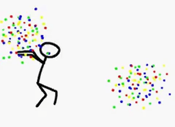

[](https://flakehub.com/flake/loganlinn/dotfiles)

> throw more dots

[](https://knowyourmeme.com/memes/50-dkp-minus-onyxia-wipe)

## tfplan-targets

Interactive fuzzy selection of Terraform resource changes, built with Fang,
Huh, and terraform-json. Requires Go 1.24.5+ to build and a terminal on macOS/Linux.

```sh
go install ./cmd/tfplan-targets

tfplan-targets tfplan                         # saved binary plan
tfplan-targets plan.json                      # terraform show -json output
terraform show -json tfplan | tfplan-targets  # stdin is the default; '-' is explicit
tfplan-targets tfplan --output stdout > targets.txt
tfplan-targets tfplan --output clipboard
```

Type to fuzzy-search addresses or actions, use arrows to move, Space/Tab to
toggle, Ctrl+A to toggle all matching rows, and Enter to submit. Selections
survive filter changes. Esc clears the query or cancels; Ctrl+C cancels.
Cancellation exits with status 130 and emits no flags or clipboard sequence.
At least one selection is required to submit. Plans without resource changes
exit successfully with a message on stderr and no output.

The menu includes changed managed resources and data reads, plus imports and
moves even when their action is `no-op`. Unchanged resources are omitted;
duplicate addresses are combined. Deferred changes and output-only changes
are not selectable resource targets.

Submission writes one line of shell-quoted flags to stdout and sends the same
text to the clipboard using OSC 52 by default (`--output both`). The UI and
clipboard sequence use `/dev/tty`, so stdin and stdout can be piped or redirected.
The terminal must allow OSC 52 clipboard writes; tmux uses passthrough and needs
`allow-passthrough on`. Clipboard acceptance cannot be confirmed by the CLI.

Paste the flags after `terraform plan`, for example:

```sh
terraform plan -target='module.app.aws_instance.web["prod"]' -target='aws_s3_bucket.logs'
```

The quotes are for pasting into a POSIX-style shell (including Bash and Zsh),
not direct `$(...)` expansion, which does not reinterpret embedded quotes.
Targets select the scope of a **new** plan; they do not modify the saved plan,
and Terraform may also include dependencies. Binary inputs require `terraform`
on PATH and the original initialized working directory; JSON inputs do not.
Stdin accepts JSON from `terraform show -json`, not the streaming UI from
`terraform plan -json`.

```sh
go test ./cmd/tfplan-targets
go vet ./cmd/tfplan-targets
```
